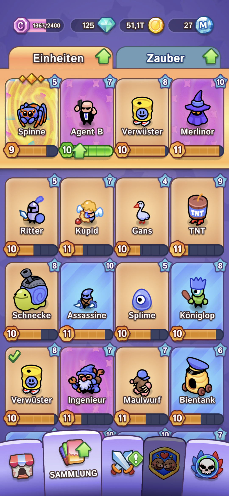
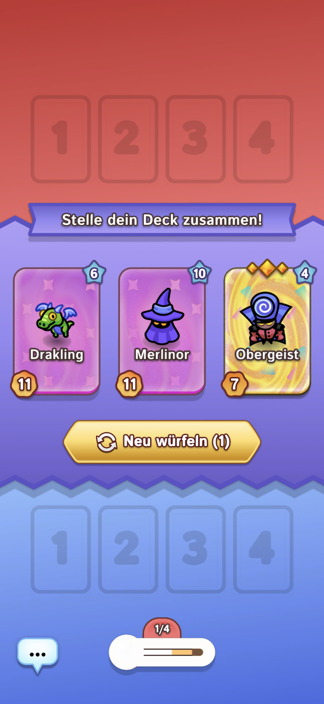
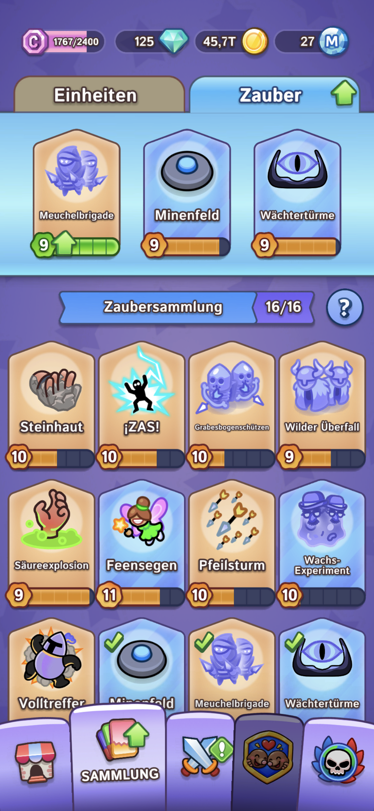
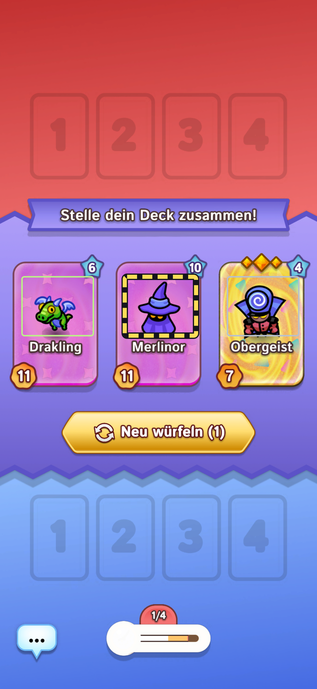
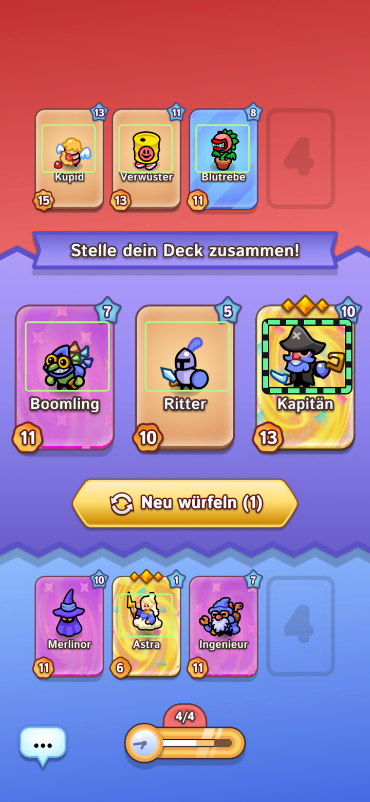

# Draft Coach

Ausbau: [Gesamtplan für den Lern- und Freigabeprozess](docs/lernprozess-gesamtplan.md) mit nummerierten Abnahmekriterien und [prüfbarem Paketstatus](docs/learning-plan.json). P1/P2 sind technisch geprüft; P3 befindet sich im Erkennungspilot. Weitere Pakete folgen getrennt.

**Truppenbeobachtung P3:** Ein zusätzlicher begrenzter CPU-Prozess untersucht beide Spielfeldbereiche, ohne die Kartenerkennung abzuwarten. Die zweisprachige Anzeige trennt Typkandidaten, sichtbare Mindestzahlen, unbekannte Ausbauformen und ältere Beobachtungen. Ein lokaler ONNX-Prototypenkandidat wird mit den bisherigen Vorlagen verglichen; ohne optionale Pakete läuft dieselbe Klassifikation mit NumPy. Die erste unabhängige Messung erreicht die Erkennungsziele **nicht**. Die Schätzungen steuern deshalb noch keine Tipps oder Klicks. [Pilotbericht und offene Abnahme](docs/p3-truppenpilot.md).

[English](README.md)

Draft Coach ist ein lokaler Begleiter für **Draft Showdown**. Er holt Android-Screenshots per ADB, erkennt sichtbare Wahlangebote mit OpenCV und bewertet sie anhand bearbeitbarer Taktikregeln. Du bedienst ihn im Browser. Die Bildverarbeitung läuft auf dem Host-PC.

Am Host-PC führt **Partien und Auswertung → Wissen und Prüfaufträge** Taktikregeln, gespeicherte Prüffälle, Prüfbilder und Archivbeobachtungen zusammen. Kennung, Herkunft und Änderungsverlauf bleiben erhalten. Bearbeitung und fachlicher Prüfstand sind getrennt. Allgemeine Mechaniken lassen sich ohne Einzelkarte oder Punktgewicht sammeln. „Bearbeitet“ aktiviert keine Regel; automatische Prüfungen und Freigabevorschläge folgen in späteren Arbeitspaketen.

**Partiesicherung und Hintergrundaufträge:** Laufende Partien werden zwischengespeichert und nach einem Neustart zur bewussten Wiederaufnahme angeboten. Abgeschlossene Ergebnisse werden genau einmal gespeichert. Lokale Aufträge für Belege und Datenvollständigkeit warten während des Spiels. Die vollständige ZIP-Sicherung enthält zusätzlich Regeln und Prüfbilder, ohne Zugangsdaten. [Umsetzung und Wiederherstellung](docs/p2-partiesicherung.md). Die Datenprüfung ist noch kein taktischer Wirksamkeitsnachweis.

## Screenshots

Diese Spielansichten nutzt der Coach als Eingabe. In den beiden Sammlungen steht die aktive Aufstellung jeweils oben.

| Einheitensammlung | Deckwahl | Zaubersammlung |
| --- | --- | --- |
|  |  |  |

### So markiert der Coach seine Auswertung

Die folgenden Referenzaufnahmen wurden mit der lokalen Erkennung und der originalen Rahmenanzeige des Coachs ausgewertet. Dünne Rahmen markieren erkannte Bereiche. Der kräftige gestrichelte Rahmen zeigt, welche Karte der Coach empfiehlt.

| Gelb gestrichelt · Versuchstipp | Grün gestrichelt · Empfehlung |
| --- | --- |
|  |  |

## Was der Coach kann

| Bereich | Funktionen |
| --- | --- |
| **Aufnahme** | USB-Debugging, geschütztes WLAN-Pairing und WLAN-Einrichtung über USB. Manuelle Aufnahme, Leertaste, Automodus und optionale Sprachbefehle. |
| **Draft und Schlacht** | Erkennt viele Einheiten, Kartenpositionen, Mengen, Aufwertungen, Verdopplungen und sichtbare Kartenwerte. Zeigt das letzte relevante Bild und markiert die Empfehlung. |
| **Bedienung** | Tipps vorlesen, Klicks akustisch melden, das Gerät im Screenshot antippen und auf Wunsch geprüfte Tipps automatisch antippen. |
| **Vorbereitung** | Überlappende Aufnahmen der Einheiten- und Zaubersammlung zusammenführen und aktive Aufstellungen erfassen. Wiederholt sicher gelesene höhere Kartenwerte können Stufe und Sterne in der Sammlung aktualisieren. |
| **Taktik** | Regeln suchen, anlegen, gewichten, testen, ändern und löschen. Die Schnellauskunft beantwortet Fragen zu Kontern und Synergien aus dem lokalen Lexikon. Eine Websuche lässt sich separat öffnen. |
| **Archiv** | Partieergebnisse erfassen. Am Host-PC abgeschlossene Partien mit bis zu 80 ausgewählten vorhandenen Belegbildern je Partie ins SQLite-Archiv übernehmen und eine Sicherung herunterladen. |

**Lernfortschritt:** In der Vorbereitung lassen sich nach dem Spiel Prüfbilder aus mehreren Partien vorschlagen und Figuren auf beiden Seiten markieren. Nur ausdrücklich als vollständig bestätigte Seiten dienen als unabhängige Testdaten; Partien ohne nachweisbare Zuordnung werden dafür ausgeschlossen. Die Auswertung hält ganze Partien zurück, zeigt Treffer und Fehler je Figur sowie gesonderte Angaben zu Anzahl und Ausbau und läuft außerhalb aktiver Spiele. Die Schwellenwerte sind vorläufig. Die experimentelle Spielfelderkennung beeinflusst Empfehlungen oder automatische Klicks nicht.

## In wenigen Schritten starten

1. **Node.js ab 22.16**, **Python 3.12** und die **Android SDK Platform Tools** installieren. `node` und `adb` müssen auffindbar sein. Alternativ lässt sich der ADB-Pfad in `.env` angeben.
2. Im Projektordner ausführen:

   ```powershell
   py -3.12 -m venv .venv
   .\.venv\Scripts\python.exe -m pip install -r requirements.txt
   powershell -NoProfile -ExecutionPolicy Bypass -File .\start.ps1
   ```

3. Am Host-PC [http://127.0.0.1:4317/](http://127.0.0.1:4317/) öffnen, oben **Deutsch** oder **English** wählen und über **Handy verbinden** ein Gerät auswählen. Die Probeaufnahme zeigt, ob die Verbindung klappt.
4. Optional `powershell -NoProfile -ExecutionPolicy Bypass -File .\install-desktop.ps1` ausführen. Die beiden Desktop-Verknüpfungen starten und stoppen den Coach. Vorhandene gleichnamige Verknüpfungen zeigen danach auf diesen Projektordner. Speichere ein offenes Partieergebnis vor dem Beenden in der Webseite.

Die Erkennung startet mit der mitgelieferten Kalibrierung. Vollständige Referenzbilder für Galerie und Benchmark lassen sich aus der privaten Sicherung nach `references/` kopieren. Die mitgelieferte Sammlung dient als Beispiel. Über **Vorbereitung** übernimmst du deine eigenen Daten.

## Heimnetz und Datensicherung

- **Host-PC** · [http://127.0.0.1:4317/](http://127.0.0.1:4317/)
- **Anderes Gerät im Heimnetz** · `http://<LAN-IP-des-Host-PCs>:4317/`. Dafür `.env.example` nach `.env` kopieren, `COACH_LAN_ADDRESS` setzen und den Coach neu starten. Die Anmeldung verwendet standardmäßig `coach` und das erzeugte Passwort aus `runtime/lan-passwort.txt`. HTTP mit Basic Auth ist für ein vertrauenswürdiges privates Netz gedacht. **Admin · Archiv** ist am Host-PC erreichbar.

Unter `runtime/` liegen Sammlung, eigene Regeln, Protokolle, Aufnahmen und die SQLite-Datenbank. Sichere diesen Ordner getrennt. Der SQLite-Download enthält die eingebetteten Belegbilder. Der laufende Aufnahmepuffer rotiert. Für einen Umzug beide Instanzen stoppen und die gewünschten Dateien kopieren. Das SQLite-Archiv gehört in `runtime/Draft-Coach.sqlite3`.

## Grenzen und Entwicklung

Die Erkennung hängt von Bildschirmgeometrie, Animationen und Kalibrierung ab. Im Zauberfenster erkennt der Coach derzeit Plätze und sichtbare Stufen. Zaubernamen, ein vollständiger Feldbestand und eine belastbare Kampfstärkeformel sind offen. Die Gewichte sind änderbare Einschätzungen. Prüfe automatische Klicks zuerst auf deinem Gerät. Browser-Spracherkennung kann einen Dienst des Browseranbieters nutzen. Die optionale Websuche übermittelt die Frage beim Öffnen der Suche.

Der Sprachumschalter wählt auch die Spielsprache für die Erkennung. Für englisch beschriftete Karten und Deckfenster gibt es experimentelle lokale Vorlagen. Wenn die Erkennung auf diese Vorlagen zurückgreift, bleibt das automatische Antippen aus. Gespeicherte deutsche Begründungen bleiben im Original verfügbar. Nach einem Sprachwechsel das Mikrofon erneut einschalten, um die neuen Sprachbefehle zu verwenden.

`npm test` startet die Node-Regressionstests. `python vision.py --file <Bild>` prüft eine einzelne Aufnahme. Mit den privaten Referenzen baut `python vision.py --build-calibration` die Vorlagen neu und `python benchmark.py` misst die Erkennung. `node smoke.mjs` benötigt einen laufenden Coach, Referenzbilder und ein ADB-Gerät.

| Datei oder Ordner | Aufgabe |
| --- | --- |
| `public/` | Weboberfläche, Rahmen, Audio, Taktikeditor und Archivverwaltung |
| `server.mjs`, `pipeline.mjs` | HTTP, ADB, Aufnahmesteuerung und Python-Prozess |
| `vision.py`, `data/calibration.npz` | OpenCV-Erkennung und abgeleitete Vorlagen |
| `advice.mjs`, `quick-advice.mjs`, `data/` | Empfehlungen, Schnellauskunft und Startdaten |
| `archive.mjs`, `data/archive-schema.sql` | SQLite-Import, Belegbilder und Sicherung |

Eigenständiges Fanprojekt zu Draft Showdown. Spielnamen und visuelle Elemente gehören ihren jeweiligen Rechteinhabern.

[Versions- und Releaseablauf](RELEASING.md)

## Partie auswerten und den Coach verbessern

Öffne am Host-PC **Partie auswerten** und lade ein Wahlfenster. Neue Partien speichern erkannte Angebote, den damaligen Tipp und den Kontext. Ältere Aufnahmen lassen sich nachträglich auswerten, solange das Bild verfügbar ist. Trage eine Beobachtung ein, prüfe die Regel im Replay und speichere den Prüffall. Mit **Testregel**, **Aktivieren** oder **Zurücknehmen** änderst du den Status. Der gespeicherte Fall sichert das zugehörige Bild, wenn es verfügbar ist. Das SQLite-Backup enthält die Prüffälle und ihre Regelhistorie.

Über **Rote Gegneranzeige korrigieren** lernt der Coach den sichtbaren Text für genau diese Aktion und Spielsprache. Wähle dazu die Figur, Aktion und Anzahl aus. In der Liste lässt sich die Vorlage deaktivieren. Taktikregeln gelten dank gemeinsamer Kartenkennungen auf Deutsch und Englisch.

Optionale GPT-Entwürfe brauchen `OPENAI_API_KEY` und `COACH_REVIEW_MODEL` in der Umgebung des Host-Prozesses. Das gewählte Modell muss Bildeingabe und strukturierte Ausgaben der Responses API unterstützen. Der Schlüssel gehört ausschließlich in die Host-Umgebung. **GPT-Entwurf erstellen** sendet die Daten des ausgewählten Wahlfensters an OpenAI. Der Kartenausschnitt wird nur bei gesetztem Häkchen mitgesendet. Pro Serverstart sind zehn Anfragen möglich. Die API kann Kosten verursachen. Du prüfst den Entwurf und entscheidest über die Aktivierung.

### Standalone-KI für die Schnellauskunft

Öffne am Host-PC **Admin · Archiv → OpenAI-API-Key** und speichere einen Schlüssel. Der Coach legt ihn im lokalen Laufzeitordner außerhalb von Git und SQLite-Sicherung ab. Alternativ kannst du OPENAI_API_KEY in der Umgebung des Host-Prozesses setzen. Beim Speichern einer Regel ergänzt der Coach fehlende Übersetzungen und aktualisiert veraltete maschinelle Fassungen. Handbearbeitete Übersetzungen bleiben zur Prüfung erhalten. Über COACH_QUICK_MODEL kannst du das Standardmodell gpt-5.4-mini ändern. In der Schnellauskunft lässt sich die Antwortquelle wählen. Die Standalone-KI sendet die Frage, passende lokale Taktiktexte und den vorherigen KI-Dialogschritt an OpenAI. Das lokale Lexikon bleibt verfügbar. Im Codex-Ablauf stellst du die Frage direkt im Codex-Chat.

Entwicklungsstand zur [Partieauswertung und zum Lernen](docs/partieauswertung-plan.md).

### Gezielte Truppen-Bildprüfung
Unter **Partien und Auswertung → Gezielte Bildfragen** prüfst du bis zu drei Bilder pro Runde. Figurentyp, Anzahl und sichtbare Form werden einzeln bestätigt; Unbekanntes bleibt offen. Antworten werden gespeichert und die Erkennungsprüfung läuft in Spielpausen automatisch. Ganze Partien bleiben als Lern- oder Testbestand getrennt. Lokal ohne API-Key. [Ablauf und Grenzen](docs/p4-bildbestaetigung.md).

### Formbezogene Aufwertung und Verdopplung
P5 speichert Entwicklungsformen und bestätigte Mengen getrennt von Kartenstufe und Sternen. Das optionale Prüfwerkzeug berechnet nur die zugeordnete Ausgangsform; Unbekanntes und Widersprüche bleiben offen. Ein gesendeter Klick ersetzt keinen bestätigten Truppenbestand. [Modell, Prüfungen und Grenzen](docs/p5-entwicklungsformen.md).
