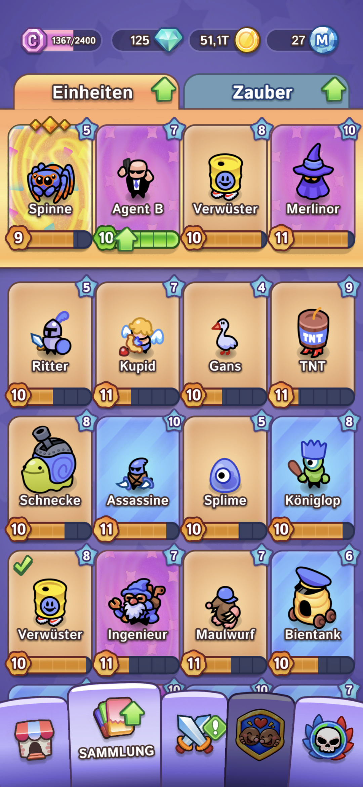
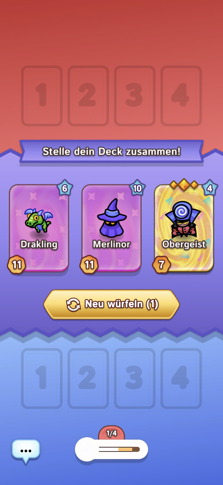
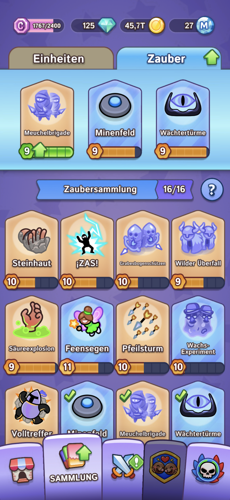
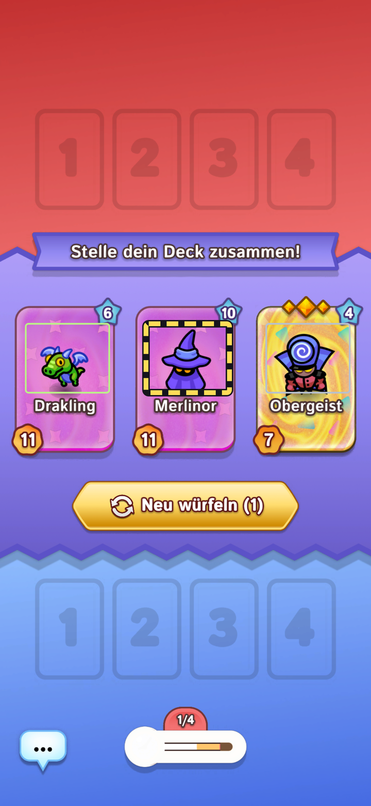
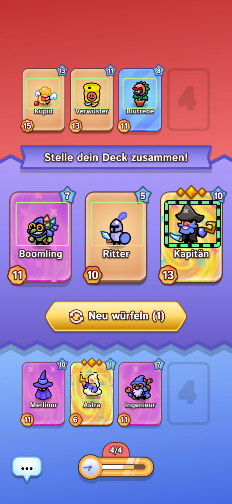

# Draft Coach

[Deutsch](README.de.md)

Draft Coach is a local companion for **Draft Showdown**. It reads the screen of an Android device via ADB, identifies visible draft and combat offers with OpenCV, and ranks those offers using editable tactical rules. The browser is the control surface. The host PC does the image processing.

## Screenshots

Examples of the Android game screens the Coach works with. The first row in each collection shows the active lineup.

| Unit collection | Deck selection | Spell collection |
| --- | --- | --- |
|  |  |  |

### How the Coach marks its recommendations

These reference captures were analysed locally and rendered with the Coach's own overlay. Thin outlines show detected regions. The thick dashed outline highlights the recommended card.

| Yellow dashes · fallback recommendation | Green dashes · recommendation |
| --- | --- |
|  |  |

## What it can do

| Area | Features |
| --- | --- |
| Capture | USB debugging, Android wireless pairing, and USB-assisted Wi-Fi setup. Manual capture, keyboard shortcut, automatic capture, and optional browser voice commands. |
| Play | Separate Draft and Battle workflows. Recognizes many unit cards, their positions, quantities, upgrades, multipliers, and visible card values. Shows the latest useful frame and highlights the recommendation. |
| Interaction | Optional spoken recommendations, browser audio feedback, manual screen taps, and optional automatic taps when the current choice passes verification. |
| Preparation | Import overlapping unit and spell collection screenshots and record active lineups. Repeated high-confidence readings can update the stored level and stars of owned units. |
| Tactics | Search, create, edit, weight, test, and delete rules. Quick Advice searches the local knowledge base for counters, combinations, and follow-up questions. An optional button opens a web search. |
| Archive | Record match outcomes. On the host PC, import completed matches into SQLite, retain up to five available evidence images per match, and download a database backup. |

## Start on Windows

1. Install **Node.js 22.16+**, **Python 3.12**, and **Android SDK Platform Tools**. Make sure `node` and `adb` are on PATH, or set `ADB_PATH` in `.env`.
2. In the checkout directory run:

   ```powershell
   py -3.12 -m venv .venv
   .\.venv\Scripts\python.exe -m pip install -r requirements.txt
   powershell -NoProfile -ExecutionPolicy Bypass -File .\start.ps1
   ```

3. Open [http://127.0.0.1:4317/](http://127.0.0.1:4317/). Choose **Deutsch** or **English** in the header. Use **Connect phone** to select a device and run a test capture.
4. To install Start and Stop shortcuts, run `powershell -NoProfile -ExecutionPolicy Bypass -File .\install-desktop.ps1`. If you already have Draft Coach shortcuts, this points them at this checkout. Save an open match through the browser before stopping the server.

The compiled calibration is included. Full reference screenshots for the optional gallery and benchmark can be placed in `references/` from your private backup. The default collection is example data. Import your own collection before relying on recommendations.

## LAN, data, and limitations

- The default listener is loopback only. For access from another device, copy `.env.example` to `.env`, set `COACH_LAN_ADDRESS` to the host's LAN IP, and restart. Use `http://<host-LAN-IP>:4317/`. LAN Basic Auth uses `coach` by default and an automatically generated password in `runtime/lan-passwort.txt` if no password is configured. HTTP Basic Auth is suitable here for a trusted private network. The archive admin stays on the host's loopback address.
- `runtime/` contains your collection, editable rules, journals, captures, and SQLite database. Back it up separately and keep it private. The SQLite download includes its embedded images. Live captures rotate. To migrate an older installation, stop both instances, copy the desired runtime files, and place the SQLite archive at `runtime/Draft-Coach.sqlite3`.
- Detection depends on layout, animation, and calibration. The spell chooser currently detects slots and visible levels. Spell names, a complete battlefield inventory, and a reliable combat-strength formula remain open. Tactical weights are editable estimates. Validate on your device before enabling automatic taps. Browser speech recognition may use a vendor service. Optional web search sends the question only when you open the search.
- The header language also selects the game-label recognition mode. English uses local fallback templates for some renamed cards and deck screens. These fallbacks are experimental and cannot trigger auto-tap. Stored German explanations remain available in their original language. If you switch languages while the microphone is on, enable it again to use the new voice commands.

## Development

`npm test` runs the Node regression suite. `python vision.py --file <image>` runs offline recognition. With the private reference images available, `python vision.py --build-calibration` rebuilds the NumPy calibration and `python benchmark.py` runs the reference benchmark. `node smoke.mjs` expects a running server, the reference gallery, and a connected ADB device.

| Component | Responsibility |
| --- | --- |
| `public/` | Browser interface, overlays, audio, tactical editor, archive controls |
| `server.mjs`, `pipeline.mjs` | HTTP, ADB, capture scheduling, and the Python worker |
| `vision.py`, `data/calibration.npz` | OpenCV recognition and derived templates |
| `advice.mjs`, `quick-advice.mjs`, `data/` | Recommendations, tactical lookup, and seed data |
| `archive.mjs`, `data/archive-schema.sql` | SQLite import, evidence, and backup |

Independent fan project for Draft Showdown. Game names and visual elements belong to their respective owners.

[Release workflow](RELEASING.md)

## Review a match and improve the coach

On the host PC, choose **Review match** and load a decision. New matches keep the recognized offers, original tip and context. Older captures can be reanalyzed while their images are available. Add an observation, preview a tactical rule against recent saved decisions, then save the case. Use **Test rule**, **Activate** or **Roll back** to manage the live rule. A saved case preserves its source image when available. The SQLite backup includes cases and their rule history.

Use **Correct red enemy banner** on a capture containing the red banner. Confirm the card, action and quantity. This learns the exact banner and action in its game language. The case list lets you disable the template. Tactical rules use shared card identifiers and apply to both languages.

Optional GPT drafts require `OPENAI_API_KEY` and `COACH_REVIEW_MODEL` in the host process environment. Choose a model compatible with Responses API image input and Structured Outputs. Never place the key in frontend code or a committed file. **Generate GPT draft** sends the selected decision details to OpenAI. The card crop is sent only when checked. Requests are limited to ten per server start. The API may bill usage. The draft remains editable, and you control which rules are activated.

### Standalone AI Quick Advice

Set OPENAI_API_KEY in the host process environment and restart the coach. COACH_QUICK_MODEL optionally overrides the default gpt-5.4-mini. Choose the answer source in Quick Advice. Standalone AI sends the question, relevant local tactic text and the preceding AI turn to OpenAI. The local knowledge base remains available. For the Codex workflow, ask the question directly in the Codex chat.
